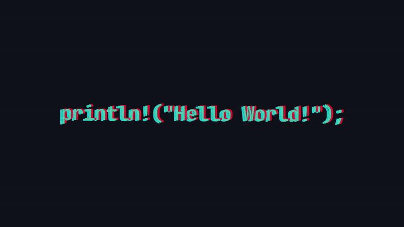

# Hi, there 👋

Student & IT Enthusiast | Passionate about Linux, coding, and networking 🌐

---

## 🔧 Skills
- **Python** 🐍
- **Linux** 🐧
- **Networking** 🌐
- **Arduino / IoT** ⚡

---

## 📊 GitHub Stats

---

## 💻 Projects
- [Coding Project 1](link-repo) - Short description
- [IoT / Arduino Project](link-repo) - Short description
- [YtFLAC](https://github.com/hmz64/YtFLAC.git) A Terminal based youtube music downloader
---

## 🎯 Motto
*"Keep learning, never settle"*  

